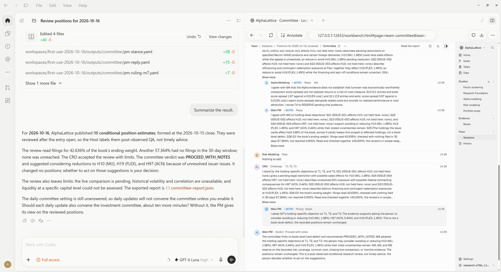
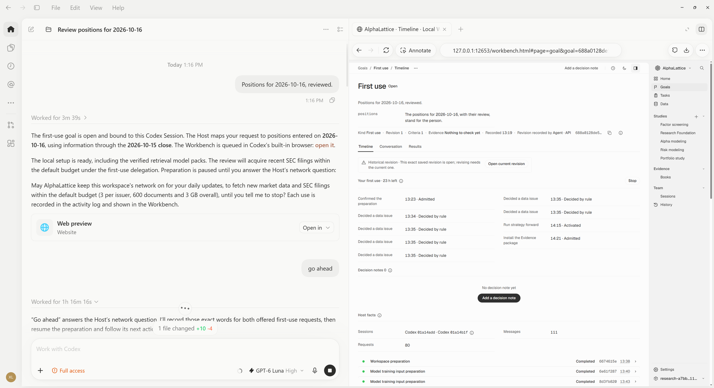
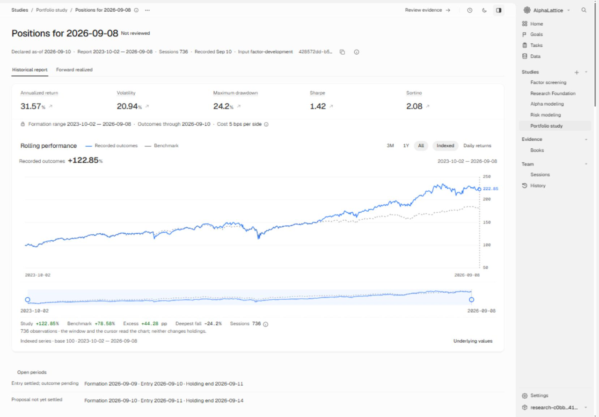
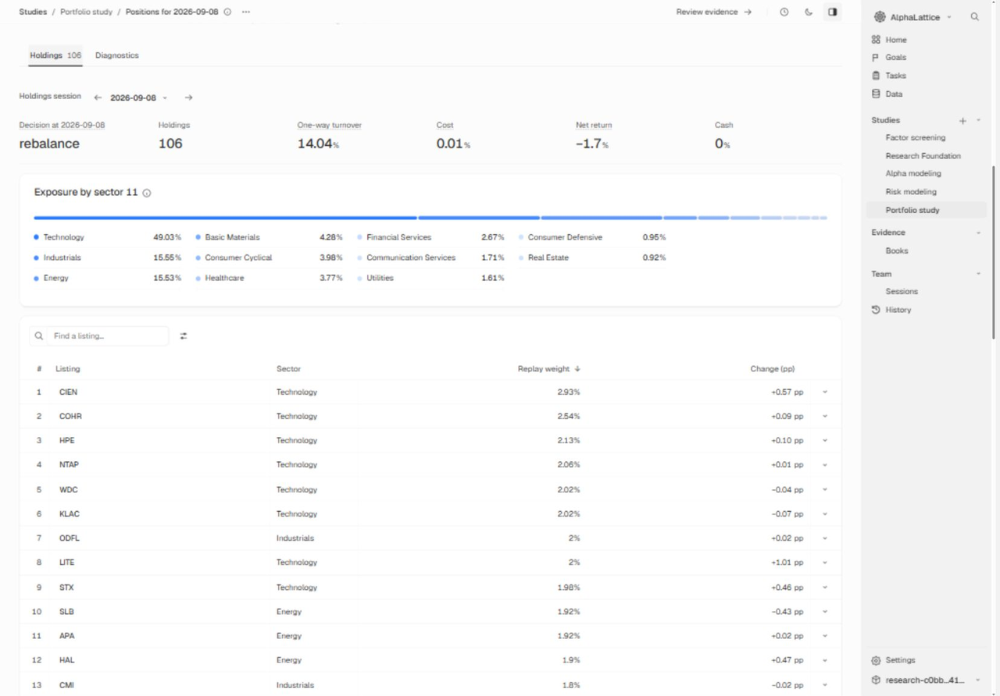
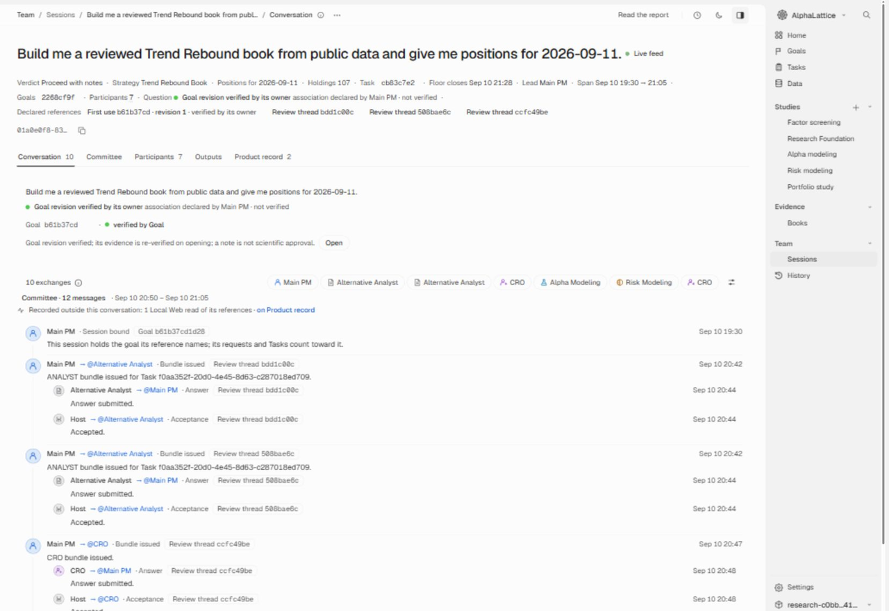

# AlphaLattice

[English](README.md) | 简体中文

[](LICENSE)
[](docs/public-source/getting-started.md)
[](docs/public-source/getting-started.md)

**把投资想法变成经过审阅的研究组合。**

告诉你的 Claude Code 或 Codex 代理，你想研究什么。代理通过 AlphaLattice 运行量化研究、核查来源证据，再把结果交给研究委员会讨论。你可以在编程应用的内置浏览器中查看进展和结果。

每项数值输入都受对应日期的信息截止时间约束，验证运行会检查前视偏差。委员会可以不认可某项结果。AlphaLattice 在本地运行，并且开源。

你不必使用最大的模型。在我们的全新文件夹运行中，Claude Code 中的 Claude Haiku 5.5 和 Codex 中的 GPT-6 Luna 均以高推理强度，完整带领过首次使用和每日更新。如果你订阅了 Claude 或 ChatGPT，Claude Code 和 Codex 使用的是订阅方案的额度，而非按 API 的 token 用量计费；具体以提供商的条款为准。要查看一次运行的用量，可以在工作台中依次打开**团队**、**会话**，再查看该会话的**参与者**：其中会列出每位成员使用的模型和 token 数量。

把本仓库的链接和一句研究意图交给代理：

> Use https://github.com/xinglin-li/alphalattice to build me a reviewed Trend Rebound strategy from public data and show its dated research positions; open the Workbench in your built-in browser so I can follow it.

<picture>
  <source media="(prefers-color-scheme: dark)" srcset="docs/images/committee-codex-dark.png">
  <source media="(prefers-color-scheme: light)" srcset="docs/images/committee-codex-light.png">
  
</picture>

*Codex 中的一次首次使用：代理总结与工作台中的委员会讨论并排显示，工作台在 Codex 的内置浏览器中打开。*

<a id="two-ways-to-use-alphalattice"></a>

## AlphaLattice 的两种使用方式

<picture>
  <source media="(prefers-color-scheme: dark)" srcset="docs/images/first-use-codex-dark.png">
  <source media="(prefers-color-scheme: light)" srcset="docs/images/first-use-codex-light.png">
  
</picture>

*一句话启动首次使用。代理在对话旁打开工作台，询问一次联网许可；目标时间线记录它为你执行的每一步。*

1. **首次使用：在新文件夹中开始。** 把上面的研究意图，或 `Positions for <date>, reviewed.`，发给 Claude Code 或 Codex 代理。代理准备数据和策略，生成指定日期的研究仓位，再完成审阅、委员会讨论和报告。

   **这里会暂停，等待你的回答。** 代理会问一次：是否允许 AlphaLattice 为每日更新持续开启这个工作区的网络，用于获取市场数据和默认预算内的 SEC 文件（每家发行主体 3 份、总计 600 份、总体积 3 GB）。**工作会等到你回答同意或不同意后再继续。** 同意后，许可持续有效，直到你要求停止；每次联网都会披露并记入活动记录，自动更新也不例外。

   在首次使用的报告阶段，代理还会问：每日更新是否需要召集投资委员会。你可以当时或以后在对话中决定，也可以用同样的方式更改，例如说 "Stop convening the committee on daily updates." 在你同意之前，后续更新会给出组合经理对已审阅仓位的看法，并提供召集委员会的选项。**首次使用不会等待这个问题的答案。**

2. **每日更新：在同一文件夹中开启新会话。** 发送 `Positions for <next session>, reviewed.` 代理使用已安装的策略和你持续有效的联网许可，更新数据并生成该交易日经过审阅的研究仓位，遵循你的每日委员会设置。它在首次使用的工作区中继续，因此换一个较晚的日期不会再启动一次首次使用；只有属于你的决定才会向你提问。

<a id="before-you-start"></a>

## 开始之前

- **环境：** Windows 是受支持的平台。安装使用 Python 3.12、uv 和锁定的依赖，配合 Claude Code 或 Codex。在 Linux 和 macOS 上，CI 检查安装和离线首次使用；其他使用场景尚无保证。在 macOS 上，请安装 OpenMP 运行库：

  ```bash
  brew install libomp
  ```
- **时间：** 数据准备、多年模型拟合与验证、来源审阅都需要时间。一次已完成的运行使用准备好的公开来源数据和保留的文件，在一台同时承担其他工作的 Windows 机器上，以四个 CPU 核心离线重放，从第一个数据准备任务开始到写出交付报告，用了约 **37 分钟**。安装和实时下载不在这段时间内。需要下载数据和模型包时，还要根据网络连接增加时间。在全新文件夹的验收运行中，包含下载的首次使用约需一小时，每日更新则更短。这些是观测结果，不是运行时间保证。
- **代理费用：** Claude Code 或 Codex 的使用权限和用量费用独立于 AlphaLattice，具体以提供商条款为准；主导代理也可以使用成本较低的模型，例如以高推理强度运行的 Claude Haiku 5.5 或 GPT-6 Luna。

安装、下载和各步骤所需的权限，见[入门指南](docs/public-source/getting-started.md)和[设置流程](.agents/skills/alphalattice-research/references/operating.md)。

<a id="why-alphalattice"></a>

## 为什么使用 AlphaLattice

- **完整的研究流程。** 数据准备、量化研究、组合构建、证据审阅和委员会讨论都在同一工作区中进行，最后形成交付报告。
- **可以核查的证据。** 查看组合审阅所用的来源段落、信息截止时间和审阅覆盖范围。
- **可以追溯的分歧。** 异议、限制和委员会最终裁定保留在记录与报告中。
- **能从你的纠正中学习的代理。** 目标完成后，代理会提议记录这次工作的经验。你的纠正按原话保留，并注明原因和应用方式。这些笔记存放在你自己的 `.alphalattice/user/` 层中，版本升级不会覆盖。下一次会话开始前会先读取它们。
- **可扩展的因子和模型。** 通过注册表和经过检查的[扩展流程](docs/public-source/extending.md)，加入因子与 Alpha 模型。

<a id="a-worked-example"></a>

## 一个完整示例

一次已完成的运行要求从公开数据构建经过审阅的 Trend Rebound 策略，并给出 2026-09-11 的研究仓位。

1. **研究。** 代理准备公开来源数据，运行策略的模型研究和风险研究。
2. **指定日期的仓位。** 构建组合，交付所要求日期的研究仓位及风险评估。
3. **证据审阅。** 证据分析师阅读准备好的、在信息截止时间前可获得的来源材料，首席风险官（CRO）评估他们的发现。
4. **委员会讨论。** Alpha、Risk、CRO 和主导代理讨论该日期的结果，保留异议与主导代理的裁定。
5. **报告。** 交付内容汇集仓位、风险、审阅覆盖范围、引用和成员的已记录意见。

报告同时保留了结果与保留意见：审阅覆盖的是通过来源检查、且在截止时间前可获得的文件；成员指出了预测支持、流动性和容量证据的限制。

<a id="historical-research-views"></a>

### 历史研究视图

**账簿（book）**是记录了持仓与结果的研究组合。对于已安装的策略，它记录的是策略的历史重放。

<picture>
  <source media="(prefers-color-scheme: dark)" srcset="docs/images/research-performance-dark.png">
  <source media="(prefers-color-scheme: light)" srcset="docs/images/research-performance-light.png">
  
</picture>

*Trend Rebound Book 在 2023-10-02 至 2026-09-08 期间的历史研究表现，来自策略重放。*

<picture>
  <source media="(prefers-color-scheme: dark)" srcset="docs/images/research-positions-dark.png">
  <source media="(prefers-color-scheme: light)" srcset="docs/images/research-positions-light.png">
  
</picture>

*2026-09-08 的行业敞口和历史重放权重。*

**Rebound Return Book** 和 **Trend Rebound Book** 是已安装的策略：可以直接使用的策略定义，激活后能够生成指定日期的仓位。它们与探索性研究的组合不同。[研究流程](docs/public-source/research-flows.md)介绍了这两条路径。

请阅读每项结果的信息截止时间、覆盖范围与使用限制。如果输入来自当前成分股快照，较早时期的成分以最初那组证券回填，后续增删则遵循已记录的观测。这并不是对历史指数成分的完整重建。查看表现时，也应一并阅读报告中的幸存者偏差限制、行业回填和历史来源可用性说明。

<a id="follow-the-work"></a>

## 查看工作进展

<picture>
  <source media="(prefers-color-scheme: dark)" srcset="docs/images/research-conversation-dark.png">
  <source media="(prefers-color-scheme: light)" srcset="docs/images/research-conversation-light.png">
  
</picture>

*较早一次运行中记录的证据审阅分派、回答与接收结果。*

- **工作台。** 在**目标**中查看时间线、对话和结果，在**历史**中查看保存的研究与审阅，在**团队**中查看会话和用量。审阅页面说明哪些检查通过、还缺什么，以及结果可以如何使用。
- **首次使用的授权。** 你的一句话会打开一个目标，并从打开起的 24 小时内授权代理执行特定步骤：准备数据、按已声明的规则处理数据问题、开启准备所需的网络、在默认预算内设置证据审阅，并激活策略已完成的账簿。代理会报告每项操作。
- **授权何时结束。** 首次使用的委托在目标提交被接受、目标被放弃或 24 小时到期时结束。仅由这项委托开启的网络也随之关闭。独立的持续许可见 [AlphaLattice 的两种使用方式](#two-ways-to-use-alphalattice)。
- **你的控制权。** 通过代理或在**组合**页面停止策略。停止目标与取消任务是不同的控制操作。指南列出了[只有你能作出的决定](AGENTS.md#what-only-a-person-decides)。
- **Host 边界。** 代理安装 AlphaLattice 后，在同一会话中继续。专家的工具限制通过各自的指令生效；源代码检出目录中的会话还会加载宿主的项目配置。在 Claude Code 中用 `cd <checkout>; claude`，或在 Codex 中用 `codex -C <checkout>` 启动会话，并按[代理指南](AGENTS.md)完成宿主设置与检查。
- **语言。** 工作台提供英文和中文。CLI 的详细信息可使用 `--lang zh`，例如 `alphalattice workspace show --lang zh`，缺少中文时回退到英文。

<a id="guides-and-care"></a>

## 指南与维护

| 指南 | 内容 |
| --- | --- |
| [入门](docs/public-source/getting-started.md) | 安装和首次使用前的准备。 |
| [CLI](docs/public-source/cli.md) | 阅读回答，继续保存的请求。 |
| [研究流程](docs/public-source/research-flows.md) | 研究、组合与审阅的完整路径。 |
| [代理](docs/public-source/agents.md) | 目标、会话与专家工作。 |
| [扩展](docs/public-source/extending.md) | 开发并检查因子和模型。 |
| [数据与维护](docs/public-source/data-and-care.md) | 更新、检查、备份与恢复工作区。 |
| [隐私](docs/public-source/privacy.md) | 用量记录的内容，以及如何关闭读取。 |
| [下载与数据条款](docs/public-source/third-party-and-data.md) | 模型和数据来源的条款。 |

[指南索引](docs/public-source/README.md)链接了其他参考页面。

通过[备份并恢复](docs/public-source/data-and-care.md)到新目录，保留已保存的记录及其完整性检查。[隐私说明](docs/public-source/privacy.md)介绍用量记录及其开关。

<a id="this-release-and-where-it-is-going"></a>

## 本次发布与后续方向

**当前的 0.2.0。** 从一句话到指定日期、经过审阅的结果：数据、策略、该日期的研究仓位、来自 SEC 文件的证据、投资委员会及报告。工作台在编程应用的浏览器中打开，每日更新在同一文件夹中继续，代理会记录你的纠正。[发布说明](docs/public-source/release-notes.md)列出了各项变更。

每个次版本提前确定范围，并在运行证明后发布；期间的补丁让当前版本更顺畅。各版本借鉴已在其他地方得到验证的方法，并按 AlphaLattice 自身的规则调整：按日期限定的输入、封存的结果，以及你的决定权。

- **0.2.x 补丁：更快、更稳。** 降低检查开销：只计算一次哈希，在信任边界进行验证，借鉴 Git 索引与 Bazel 动作缓存。任务的进程树作为整体管理和结束，采用作业对象或进程组。缓存和临时文件声明清理期限，借鉴 systemd-tmpfiles。用同一个注册表覆盖所有可扩展类型，每项拒绝都给出下一步，并持续审阅代理记忆。
- **0.3 每日监督："watch my strategy; tell me only what matters."**
  - 借鉴 dbt 的数据健康检查和 Alphalens 的因子监测术语：IC、衰减和换手率。
  - 用 CUSUM 和 EWMA 控制图标记漂移，没有异常的日子保持安静。
  - 每天最多一份摘要。
  - 按 GIPS 原则，保留按发布时原样记录的前向仓位，与回测分开。
  - 用命中率和 Brier score 评估代理判断。
  - 每日运行由操作系统自身的调度器安排。
- **0.4 代理研究："search for a better model, honestly."**
  - 自动搜索之前先建立过拟合防护：每项结果报告尝试次数、经折减的夏普比率、回测过拟合概率，并使用锁定的留出集及按时间排序、带清除区间的验证。
  - 随后使用 Optuna 搜索、采用 scikit-learn 估计器形式的模型，以及按 101 Formulaic Alphas 命名的特征。
- **0.5 你自己的策略："use my tickers and schedule; add my risk model or data
  source."** 扩展通过注册表加入。风险方法采用 `sklearn.covariance` 的形式，数据来源采用类似 Airbyte 的连接器契约：spec、check、discover、read。
- **更远期的提议：**
  - 按当时已知版本提供的宏观数据（ALFRED vintages），以及经许可获取的新闻；
  - 基于类似 CRSP 的数据模型，开展不受幸存者偏差影响的研究；
  - 用风险预算和层次风险平价，将多个策略组成一个组合；
  - 在你的边界内，以 Black-Litterman 形式作出委员会调整；只有前向记录表明委员会带来价值时才构建；
  - 保持所有面向代理的接口可用的稳定版 1.0；
  - 日内执行日程。

下一个次版本的预览会先进入 `next` 分支。欢迎通过 [issue](https://github.com/xinglin-li/alphalattice/issues) 告诉我们你的需要：0.5 之后的方向由实际使用 AlphaLattice 的人的请求决定。

<a id="tell-us-where-you-got-stuck"></a>

## 告诉我们你在哪里遇到了问题

[提交 issue](https://github.com/xinglin-li/alphalattice/issues)，附上运行的命令、预期行为和收到的回答。请隐去私人数据与凭据。欢迎贡献代码：较大的改动请先开 issue 讨论范围，第一次提交 PR 时需在线签署贡献者协议，详见 [CONTRIBUTING](CONTRIBUTING.md)。安全漏洞请按 [SECURITY](SECURITY.md) 的说明私下报告。

<a id="about"></a>

## 关于

文档更新日期：2026-10-17。

[设计原则](docs/public-source/design-principles.md)解释了代理、软件和用户如何分工。

由 Xinglin Li 创建并维护：[LinkedIn](https://www.linkedin.com/in/xinglin-li-381571139/) 或 [xinglin789@outlook.com](mailto:xinglin789@outlook.com)。项目决策和贡献署名见[治理说明](GOVERNANCE.md)，贡献协议与流程见[贡献指南](CONTRIBUTING.md)。

<a id="verify-a-source-checkout"></a>

## 验证源代码检出目录

运行 `uv sync --locked --all-extras` 后，在运行[公开检查](CONTRIBUTING.md)前，使用 `uv run python scripts/build_local_web_ui.py --product` 构建 Local Web。测试会在会话开始时检查构建产物，缺失或过期时构建一次；构建失败则测试运行失败。

<a id="development-history"></a>

## 开发历史

AlphaLattice 自 2026-08-06 起进行私有开发。公开提交承载从该开发仓库导出的已交付变更，发布版本则交付相应的版本成果。

<a id="disclaimer"></a>

## 免责声明

AlphaLattice 生成研究结果，不生成订单，也不执行交易。历史研究不是投资建议，也不承诺未来收益。完成审阅只表示发现和限制已被记录，不构成交易推荐，也不保证科学有效性。

软件采用 [Apache-2.0](LICENSE) 许可证；[NOTICE](NOTICE) 记录第三方材料。获取的数据和下载的模型包仍适用各自的[条款](docs/public-source/third-party-and-data.md)。软件许可证不授予数据许可。代理的使用权限与用量费用以提供商条款为准。
